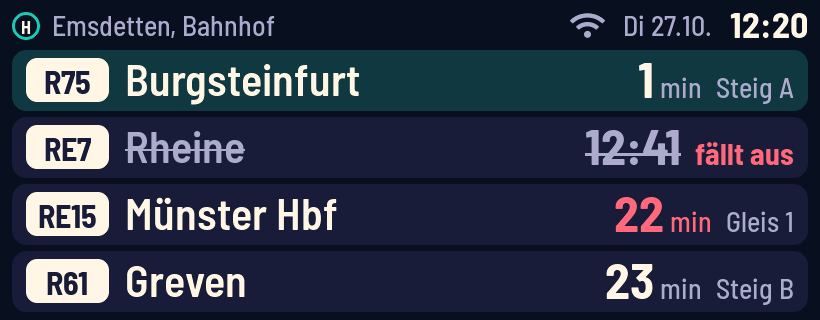
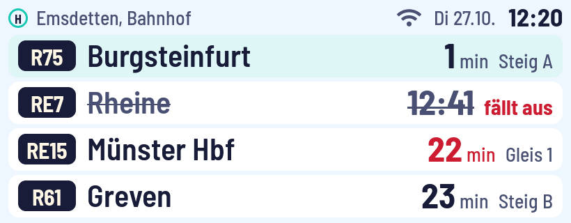
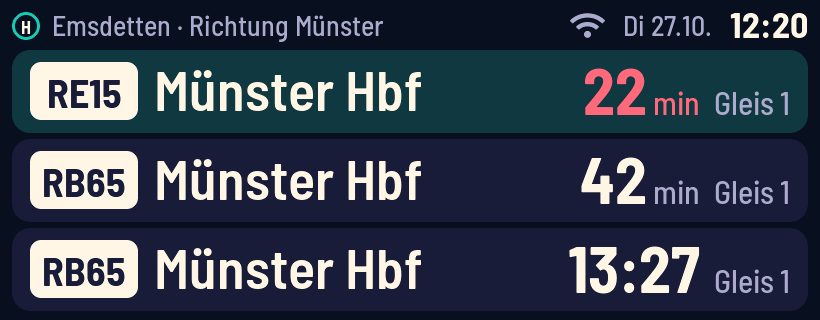
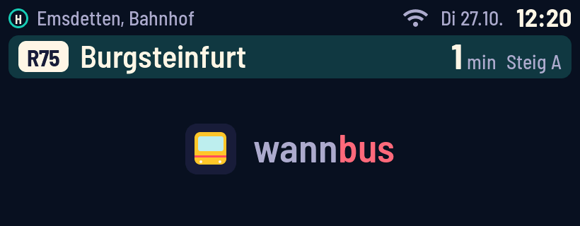
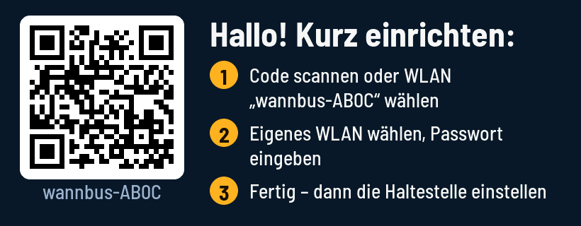
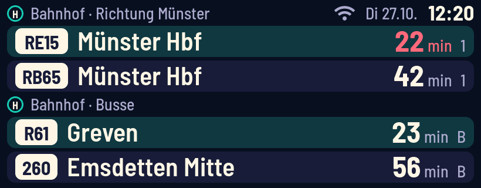
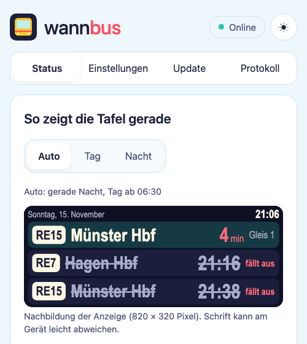
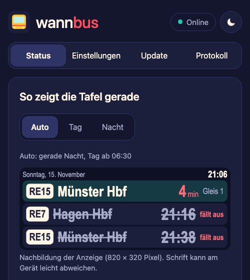
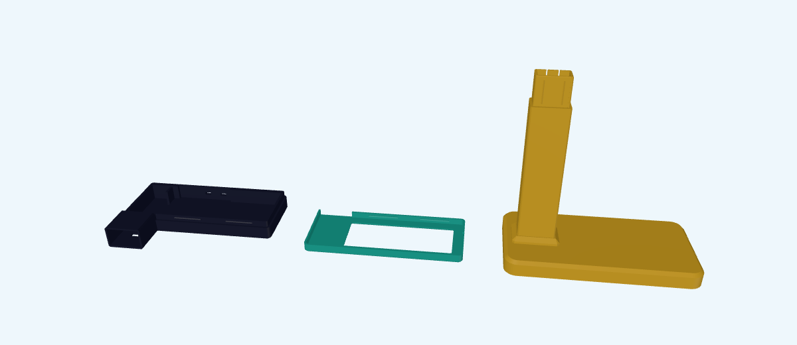
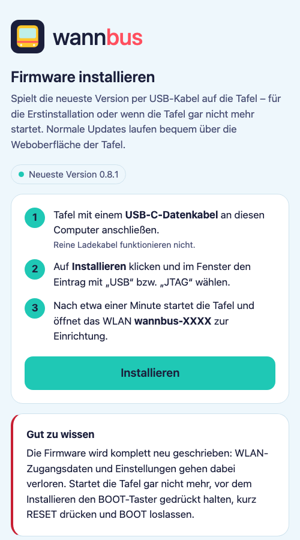

<p align="center">
  <picture>
    <source media="(prefers-color-scheme: dark)" srcset="docs/readme/banner-dark.png">
    
  </picture>
</p>

<p align="center">
  <a href="https://github.com/NilsAla/wannbus/releases/latest"></a>
  <a href="https://nilsala.github.io/wannbus/"></a>
  <a href="LICENSE"></a>
</p>

<p align="center">
  <b>Wann kommt mein Bus?</b> Eine kleine Abfahrtstafel im Haltestellen-Look für Flur, Küche oder Büro.<br>
  Läuft komplett auf dem Gerät – kein Server, kein Home Assistant, keine App, kein Konto.
</p>

<p align="center">
  
</p>

---

## Was wannbus kann

- 🚌 **Echtzeit-Abfahrten** für Bus, Bahn, Tram und Fähre in ganz Deutschland und vielen Ländern Europas
  ([Transitous](https://transitous.org/)) – Verspätungen in Koralle, Ausfälle durchgestrichen
- 🎯 **Bis zu zwei Haltestellen**, auf Wunsch nur bestimmte Linien und Richtungen, mit Fußweg-Zeit
- 🌗 **Tag- und Nachtdesign** – automatisch nach Uhrzeit oder fest, dazu ein Nachtfenster mit eigener Helligkeit
- 📱 **Einrichtung am Handy** – WLAN-Assistent mit QR-Code, danach Weboberfläche unter `http://wannbus.local`
- 🔄 **Updates per Knopfdruck** – geprüft per SHA-256, bei Problemen automatisch zurück zur alten Version
- 🧪 **Beta-Kanal** zum Ausprobieren neuer Versionen, mit einem Häkchen ein- und ausschaltbar
- 🛟 **Robust** – zeigt bei Störungen die letzten Daten mit Uhrzeit, jede Fehlermeldung im Klartext
- 🔒 **Privat** – keine Cloud, keine Telemetrie; die Tafel spricht nur mit Transitous, GitHub (Updates) und Zeitservern

## So sieht es aus

| Abfahrten (Nacht) | Abfahrten (Tag) |
|---|---|
|  |  |
| **Größere Schrift (3 Zeilen)** | **Wenig los** |
|  |  |
| **Erster Start: WLAN einrichten** | **Zwei Haltestellen** |
|  |  |

<table>
  <tr>
    <td width="50%"><b>Weboberfläche (hell)</b><br></td>
    <td width="50%"><b>Weboberfläche (dunkel)</b><br></td>
  </tr>
</table>

Alle Display-Zustände (Fehler, Update, Einrichtung, Nacht): [`docs/screens/`](docs/screens/README.md)

## Das brauchst du

| | |
|---|---|
| **Display** | [Waveshare ESP32-S3-LCD-3.16](https://www.waveshare.com/esp32-s3-lcd-3.16.htm) – ESP32-S3 mit 16 MB Flash, 8 MB PSRAM, 3,16″-IPS-Display (820 × 320) |
| **Strom** | USB-Netzteil 5 V (ab 1 A) und ein USB-C-Kabel mit **rechtwinkligem Stecker** (passt ins Gehäuse) |
| **Gehäuse** | 3 Teile aus dem 3D-Drucker, nur gesteckt – [`hardware/gehaeuse/`](hardware/gehaeuse/) |
| **Computer** | einmalig zum Installieren: Chrome oder Edge am PC/Mac und ein USB-C-**Daten**kabel |

## Installation in 5 Schritten

### 1 · Gehäuse drucken


Drei Teile ([`hardware/gehaeuse/`](hardware/gehaeuse/)): Gehäuse, Deckel, Fuß. **Kein Support** nötig, und zusammengebaut
wird nur durch **Stecken** – keine Schrauben, kein Kleber. Den Ein/Aus-Schalter des Boards vor dem Einbau auf **ON**
stellen. Zum Betrieb braucht es ein USB-C-Kabel mit **rechtwinkligem Stecker**.
[Zusammenbau](hardware/gehaeuse/README.md)

### 2 · Firmware aufspielen
Am besten vor dem Einbau ins Gehäuse.



1. **[nilsala.github.io/wannbus](https://nilsala.github.io/wannbus/)** in Chrome oder Edge öffnen
2. Tafel per USB-C-Datenkabel anschließen
3. **Installieren** klicken und den Eintrag mit „USB“ bzw. „JTAG“ wählen
4. Nach etwa einer Minute ist die Tafel fertig

Klappt die Verbindung nicht: BOOT-Taster gedrückt halten, kurz RESET drücken, BOOT loslassen und noch einmal versuchen.

<br clear="right">

### 3 · WLAN einrichten
Die Tafel zeigt einen QR-Code und öffnet das WLAN **`wannbus-XXXX`**.
QR-Code mit dem Handy scannen (oder das WLAN von Hand wählen) → **WLAN einrichten** → eigenes WLAN antippen →
Passwort eingeben → **Verbinden**.

### 4 · Haltestelle wählen
Die Tafel startet einmal neu und zeigt einen zweiten QR-Code. Scannen oder im Browser **`http://wannbus.local`** öffnen
(geht `.local` nicht, steht die IP-Adresse auf dem Display). Unter **Einstellungen** die Haltestelle suchen, antippen,
optional nur bestimmte Linien wählen → **Speichern**. Fertig – nach wenigen Sekunden erscheinen die Abfahrten.

### 5 · Aufstellen
Netzteil anschließen, hinstellen, fertig. Updates meldet die Tafel selbst; installiert wird nur, wenn du in der
Weboberfläche unter **Update** auf **Update installieren** tippst.

**Zurücksetzen:** BOOT-Taster 10 Sekunden gedrückt halten – löscht WLAN und Einstellungen, die Einrichtung beginnt neu.
Kurzanleitung zum Ausdrucken: [`docs/ANLEITUNG.md`](docs/ANLEITUNG.md)

## Für Entwickler

PlatformIO (pioarduino, arduino-esp32 3.3), LVGL 9.3, ESPAsyncWebServer, ArduinoJson, WiFiManager.
Was angezeigt wird, entscheidet die board-unabhängige Logik in `lib/` (Unit-Tests auf dem PC), `src/ui` zeichnet nur.

```sh
pio test -e native                  # Unit-Tests auf dem PC
pio run -e esp32s3 -t upload        # Firmware bauen und per USB flashen
pio run -e sim && python3 scripts/render_screens.py   # Display-Screens als PNG nach docs/screens/
scripts/release.sh 1.2.0 "Notiz"    # Release lokal bauen und veröffentlichen (…-beta.N = Beta-Kanal)
```

| Release-Datei | Wofür |
|---|---|
| `firmware.bin` | Updates per Weboberfläche |
| `firmware-factory.bin` | Erstinstallation ab Adresse `0x0` (macht die Flash-Seite) |
| `manifest.json` | Version, Größe und SHA-256 für den Update-Mechanismus |
| `firmware.elf` | nur zum Auswerten von Absturzberichten |

Mehr: [Architektur](docs/ARCHITEKTUR.md) · [Hardware](docs/HARDWARE.md) · [Roadmap](docs/ROADMAP.md) ·
[Design](docs/branding/BRANDING.md)

## Daten und Lizenz

Abfahrtsdaten von [Transitous](https://transitous.org/) ([Datenquellen](https://transitous.org/sources/)),
Kartendaten © [OpenStreetMap](https://www.openstreetmap.org/copyright)-Mitwirkende. Nicht-kommerzielles Projekt.
Code unter [MIT-Lizenz](LICENSE); Schrift Barlow (OFL), Symbole Font Awesome (siehe `assets/fonts/`).
