# UI-Mockups (Entwurf)

Erste Entwürfe für Display und Web-UI, Stand 2026-10-26. Inhalte aus einem echten Transitous-Abruf am
Bahnhof Emsdetten (12:20 Uhr). Die Bilder sind in doppelter Auflösung gerendert; das Display hat
820 × 320 Pixel bei rund 68 × 26 mm, also etwa 0,08 mm pro Pixel.

Umgesetzt in M4: Die echten Display-Screens liegen in `docs/screens/` (gerendert mit LVGL aus `env:sim`).
Die Web-UI nutzt weiterhin das grüne Design aus M1.

Bearbeitbares Original (Canvas, privat): https://claude.ai/artifact/MXckhM5JGMiyous1Ga2iqQ

## Display

### 4 Zeilen, alle Abfahrten
Linien-Badge in Originalfarbe, Minuten bis zur Abfahrt, Steig/Gleis rechts. Ausfälle stehen zur
Planzeit, durchgestrichen mit „fällt aus“. Verspätung über der Gleisangabe.

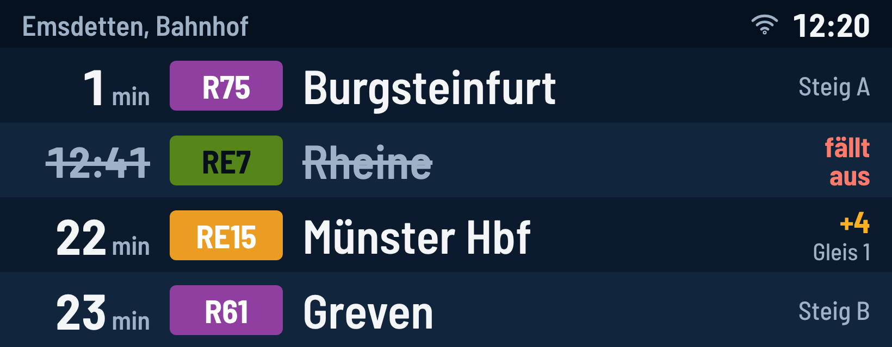

### Stil-Varianten
| Bernstein (LED-Optik) | Hell |
|---|---|
| 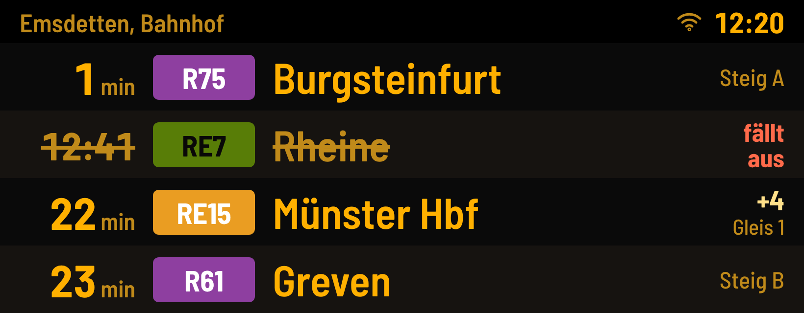 | 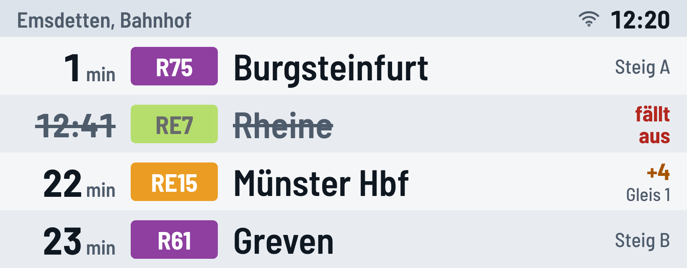 |

### 3 Zeilen, nur Richtung Münster
Größere Schrift für 1–2 m Leseabstand. Ab 60 Minuten Uhrzeit statt Minuten.

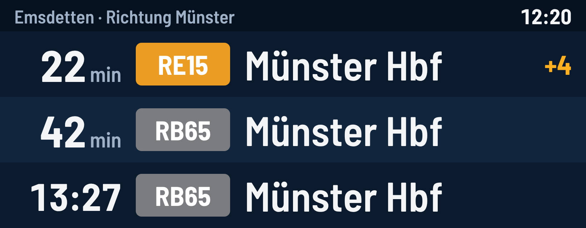

### Zwei Haltestellen geteilt
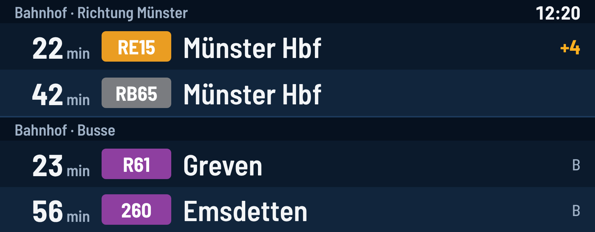

### Zustände
| Erststart | WLAN weg, alte Daten |
|---|---|
| 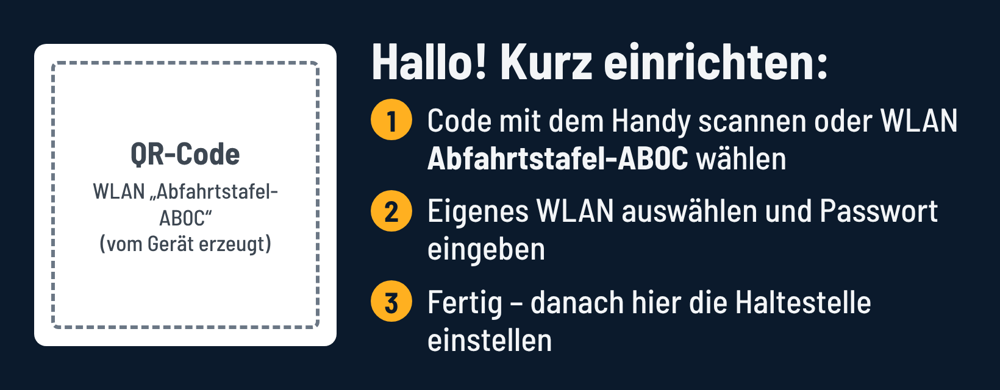 | 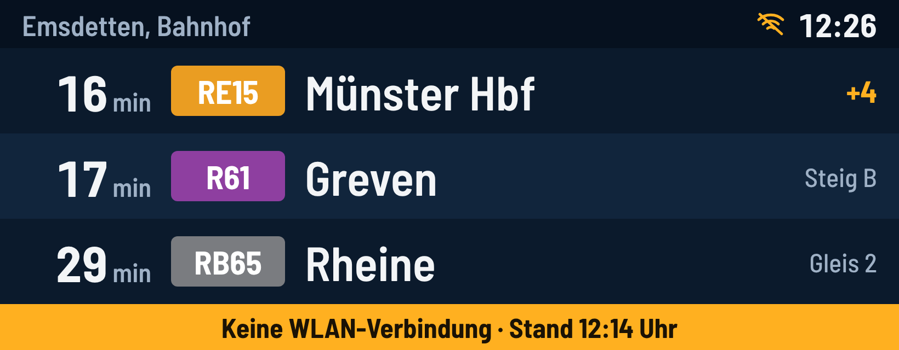 |

| Update läuft |
|---|
| 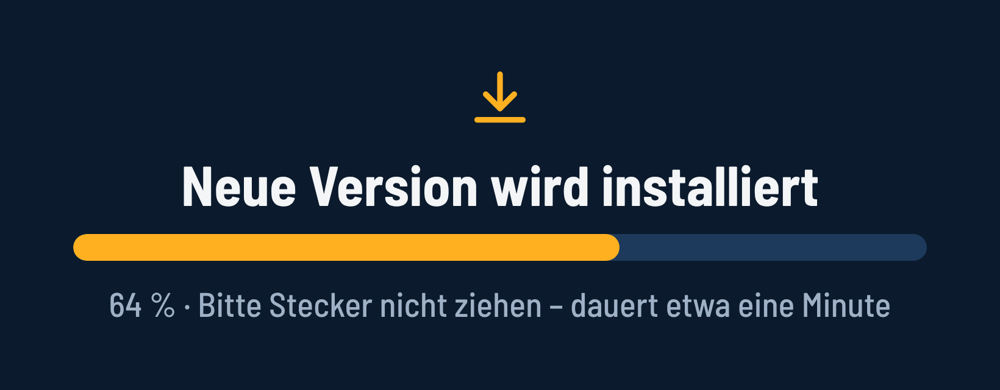 |

## Web-UI (Handy)
Gleiche Farbwelt wie das Display (Nachtblau, Bernstein-Akzent).

| Status mit Vorschau | Haltestelle & Richtungen | Update |
|---|---|---|
| 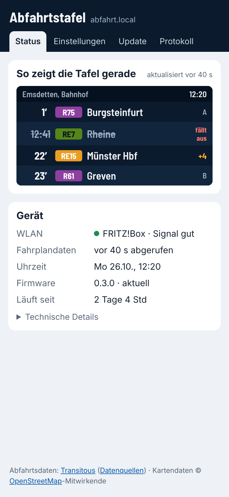 | 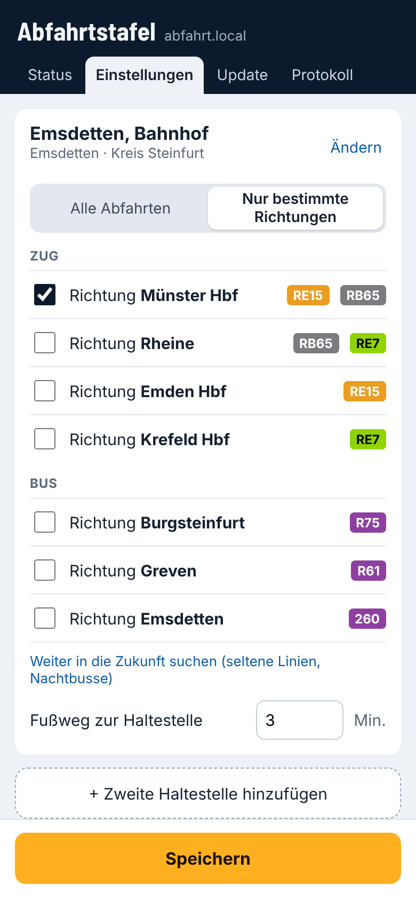 | 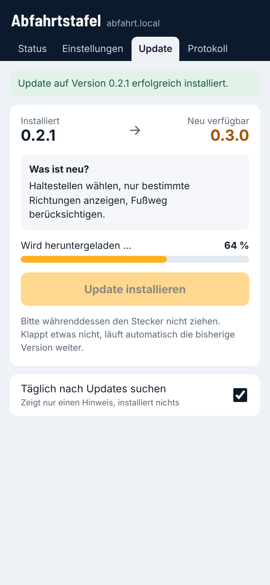 |

## Entscheidungen (M4)
- Zeilenzahl: 3 oder 4 per Einstellung in der Web-UI, Standard 4 – endgültig am echten Panel festlegen
- Stil: Nachtblau („Dunkel“, Standard) und Bernstein („Nacht“), Umschalter in der Web-UI; Hell entfällt
- Schrift: Barlow Semi Condensed (OFL)
