# Display-Screens

Automatisch gerendert aus `env:sim` (LVGL, RGB565 wie am Gerät, 820 × 320 px ≈ 68 × 26 mm):

    pio run -e sim
    python3 scripts/render_screens.py

Beispieldaten: Emsdetten, Bahnhof, Dienstag 12:20 Uhr. Szenarien in `src/sim/sim_main.cpp`.

## Abfahrten
| Nacht (Standard) | Tag |
|---|---|
| 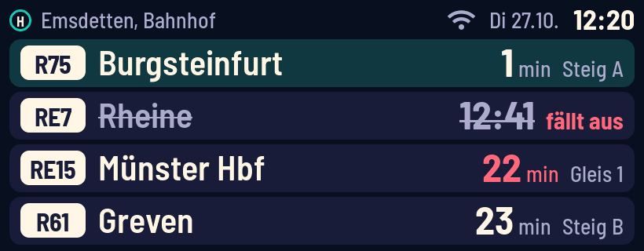 | 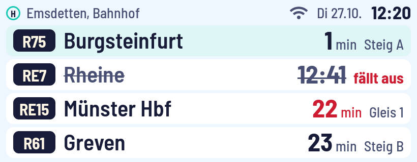 |
| 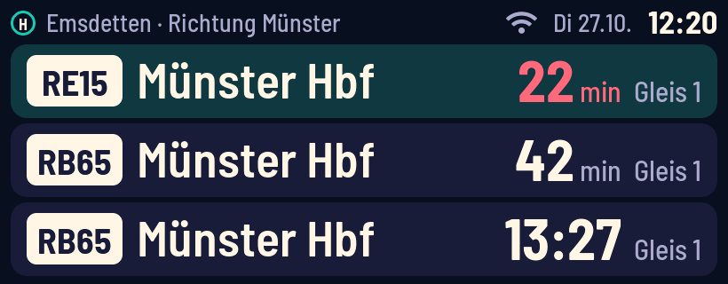 | 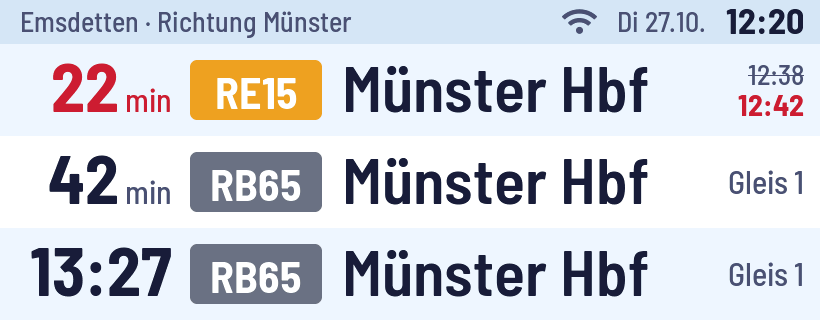 |

## Haltestellenname (Einstellung)
| Groß | Ausblenden (nur Datum und Uhr) |
|---|---|
| 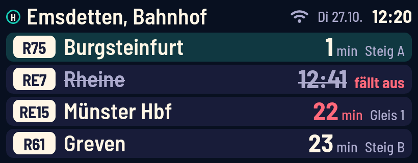 | 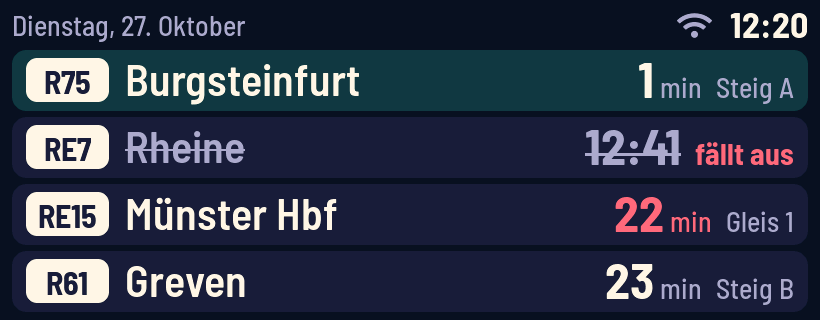 |
| 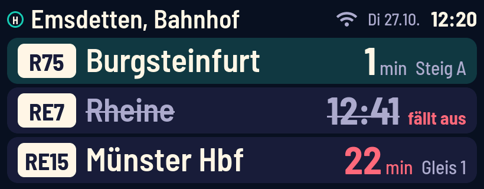 | 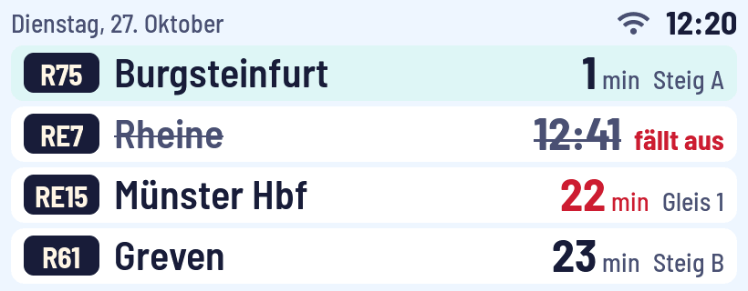 |

Verspätung ab +2 min: Minuten rot (enthalten die Verspätung), rechts Planzeit durchgestrichen und neue Zeit.

Lange Namen werden gekürzt, Badges wachsen bis 170 px:

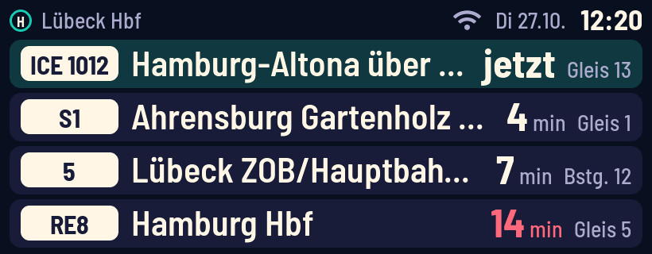

## Zwei Haltestellen
| Untereinander | Im Wechsel (alle 10 s, mit Update-Hinweis) |
|---|---|
| 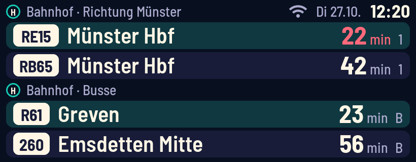 | 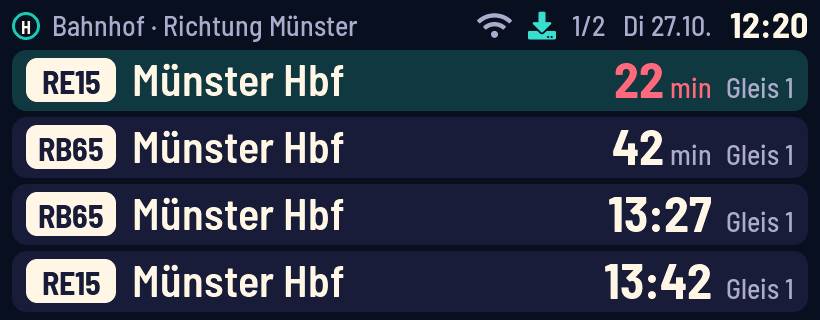 |
| 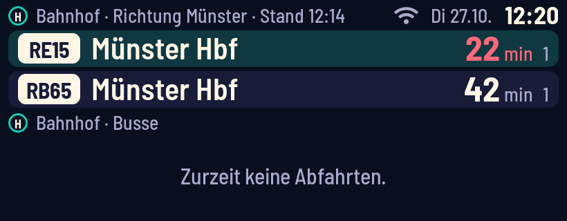 | 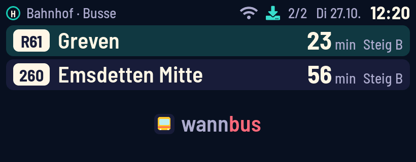 |

## Veraltete Daten
| WLAN weg | Fahrplandaten weg (Tag) |
|---|---|
| 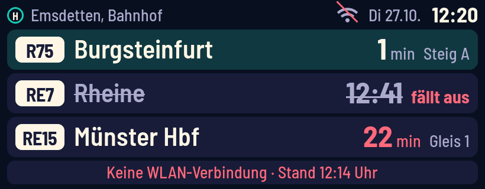 | 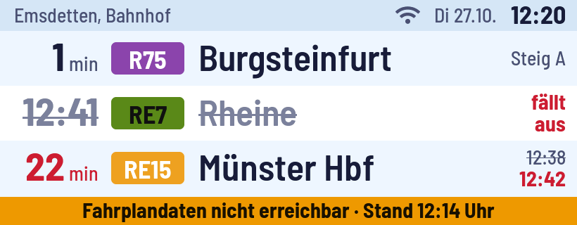 |

## Einrichtung
| Erststart | Nach dem Portal (Neustart) | Keine Haltestelle (QR auf die IP) | WLAN nicht erreichbar |
|---|---|---|---|
| 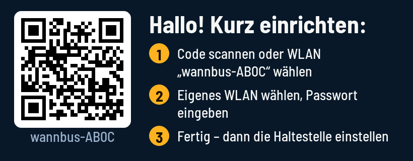 | 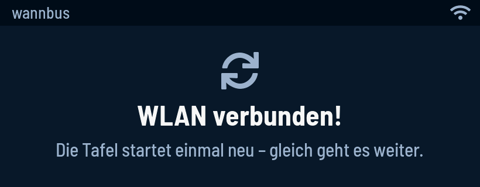 | 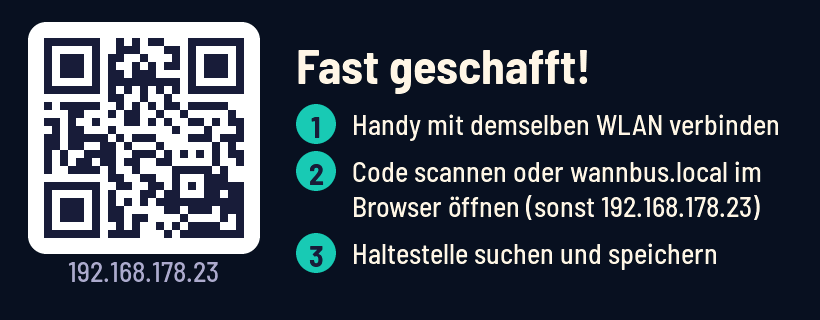 | 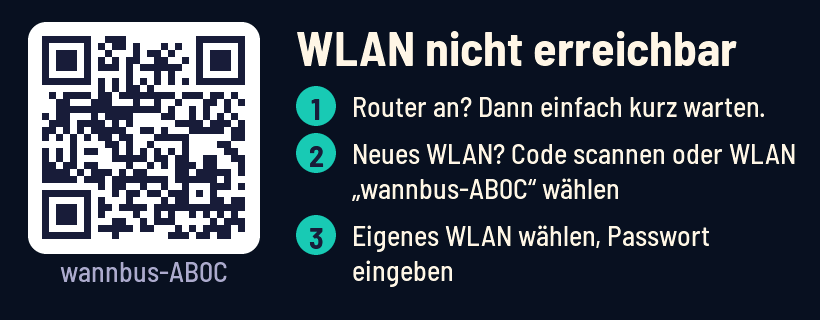 |

## Meldungen
| | |
|---|---|
| 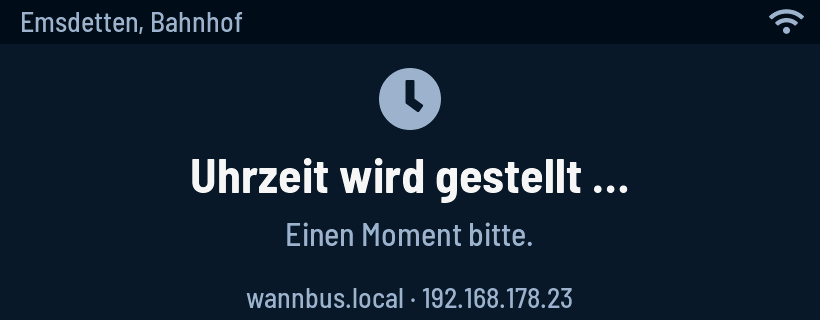 | 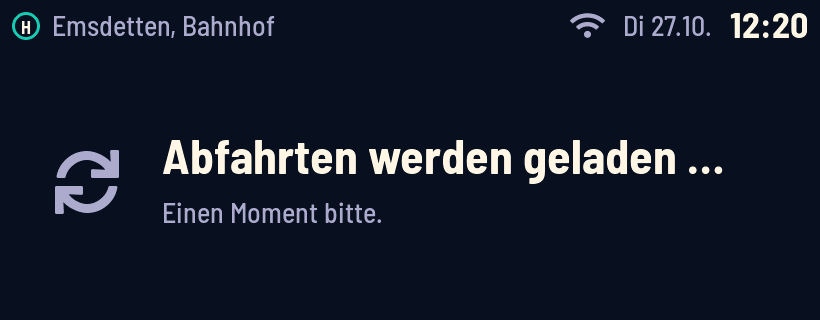 |
| 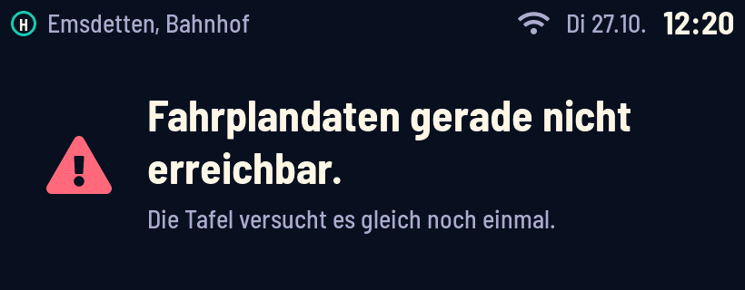 | 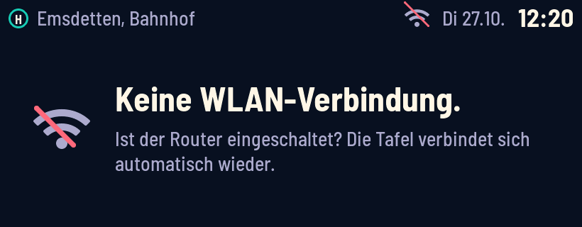 |
| 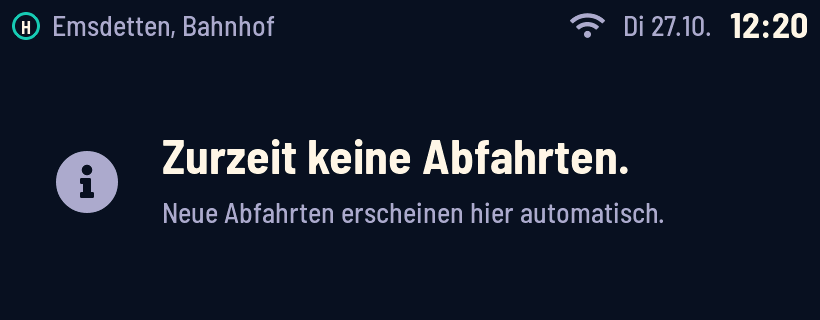 | 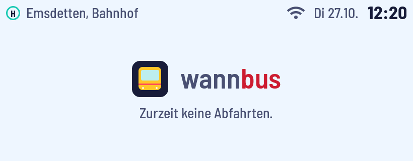 |

## Update
| Läuft | Neustart (Tag) |
|---|---|
| 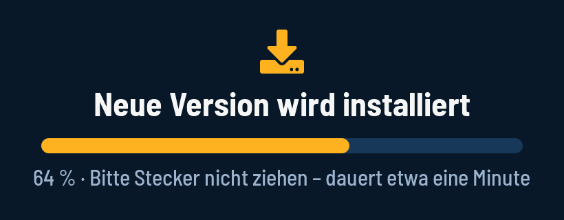 | 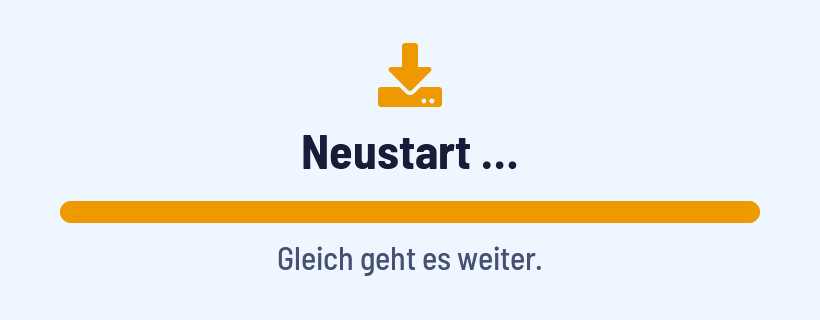 |
