# Display-Screens

Automatisch gerendert aus `env:sim` (LVGL, RGB565 wie am Gerät, 820 × 320 px ≈ 68 × 26 mm):

    pio run -e sim
    python3 scripts/render_screens.py

Beispieldaten: Emsdetten, Bahnhof, Dienstag 12:20 Uhr. Szenarien in `src/sim/sim_main.cpp`.

## Abfahrten
| Dunkel | Nacht |
|---|---|
| 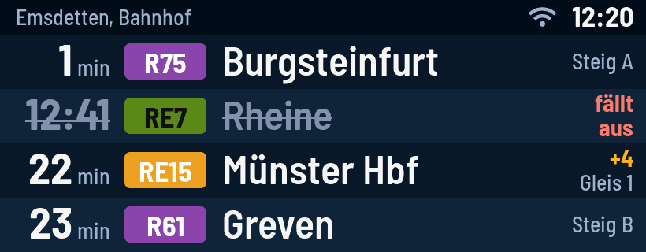 | 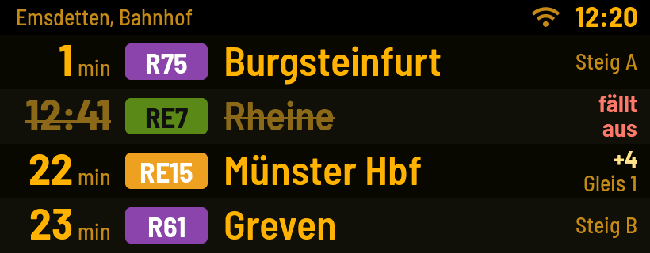 |
| 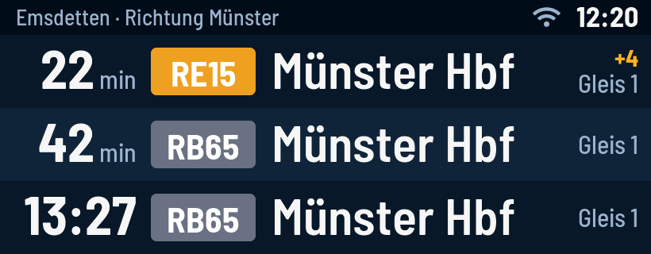 | 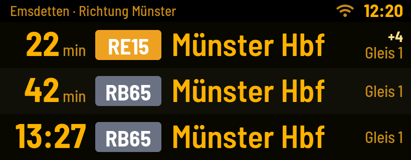 |

Lange Namen werden gekürzt, Badges wachsen bis 170 px:

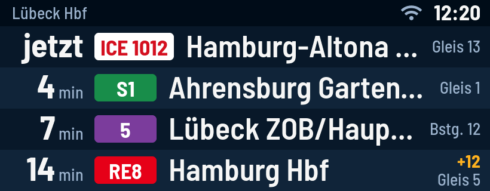

## Zwei Haltestellen
| Untereinander | Im Wechsel (alle 10 s, mit Update-Hinweis) |
|---|---|
| 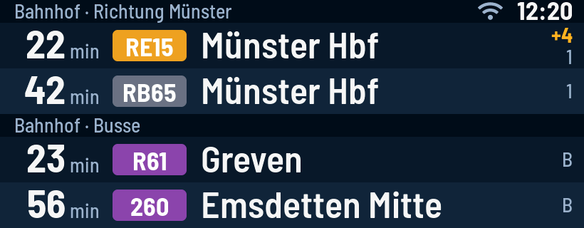 | 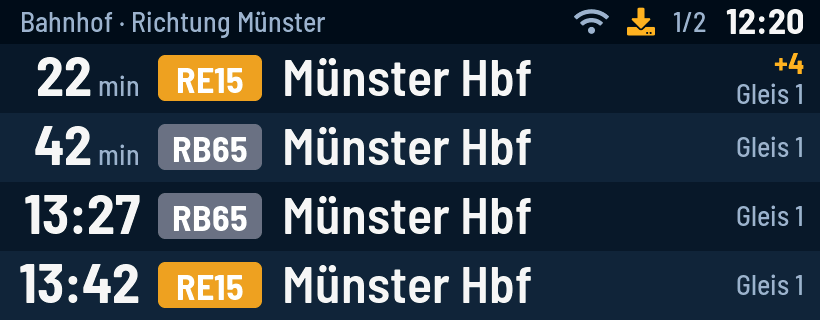 |
| 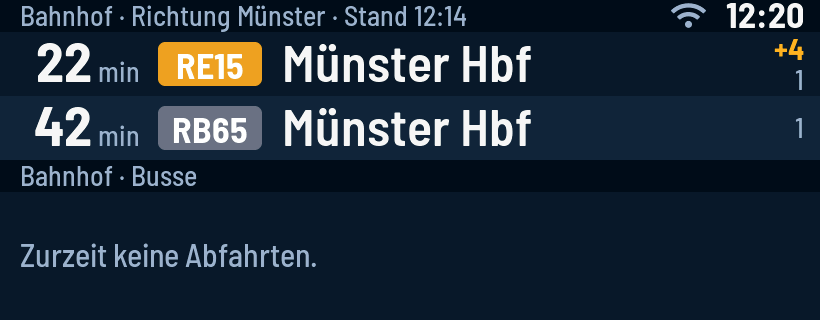 | 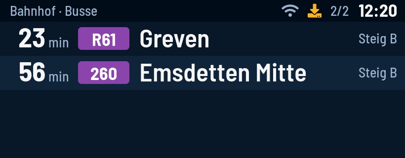 |

## Veraltete Daten
| WLAN weg | Fahrplandaten weg (Nacht) |
|---|---|
| 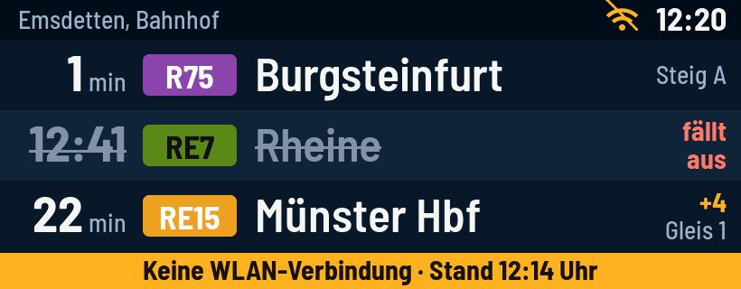 | 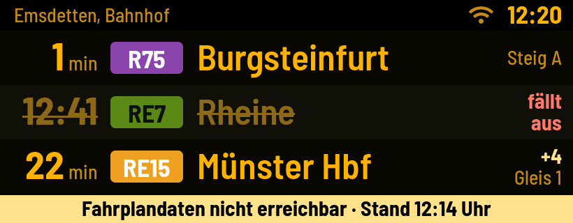 |

## Einrichtung
| Erststart | Keine Haltestelle | WLAN nicht erreichbar |
|---|---|---|
| 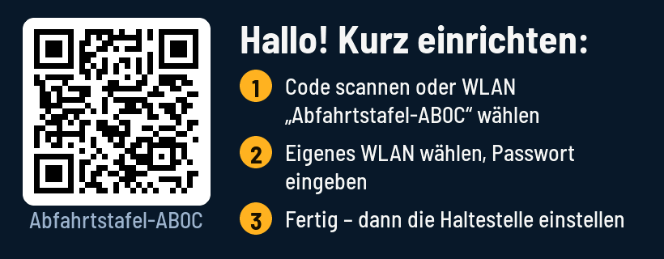 | 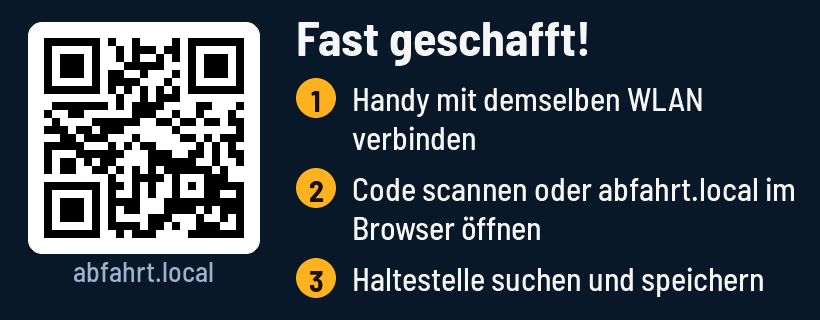 | 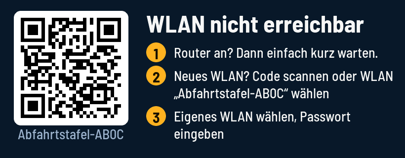 |

## Meldungen
| | |
|---|---|
| 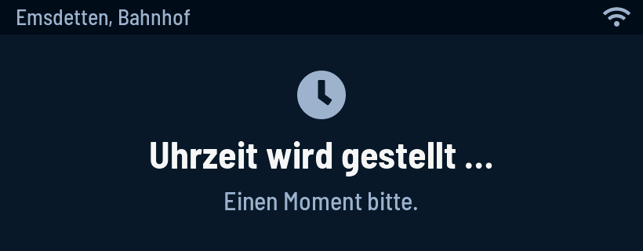 | 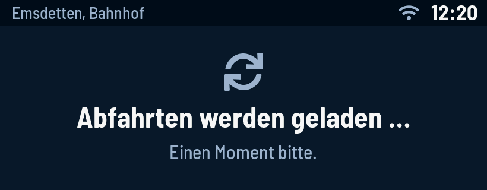 |
| 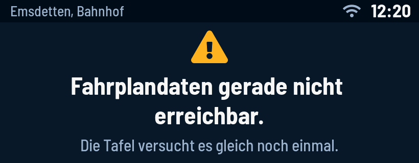 | 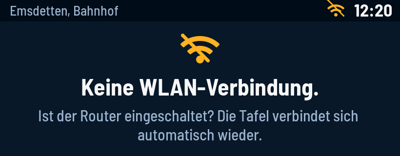 |
| 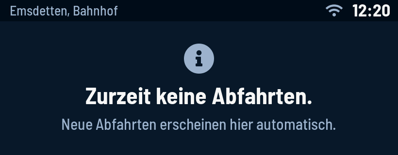 | 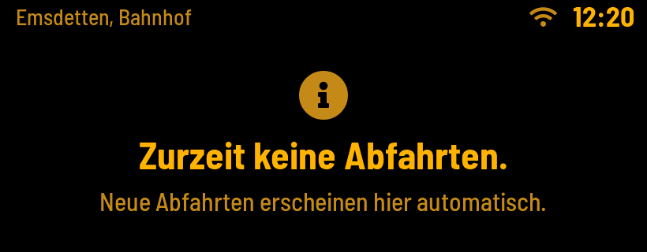 |

## Update
| Läuft | Neustart (Nacht) |
|---|---|
| 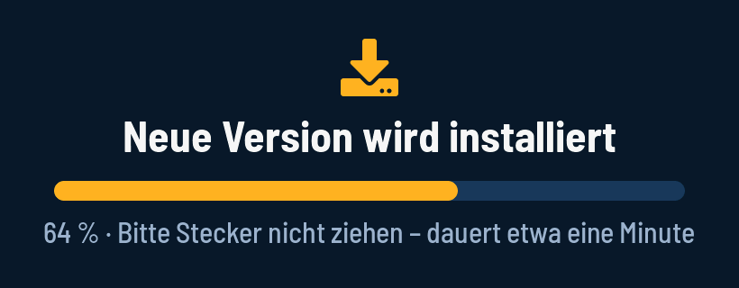 | 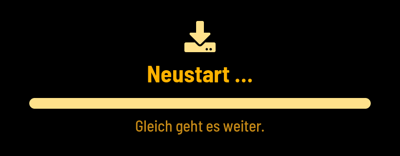 |
