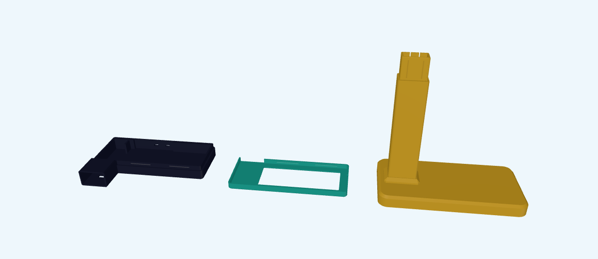

# Gehäuse

Drei Teile, alles wird **gesteckt** – keine Schrauben, kein Kleber, **kein Support** beim Drucken.

| Datei | Teil | Maße (mm) |
|---|---|---|
| [`wannbus-gehaeuse.stl`](wannbus-gehaeuse.stl) | Gehäuse für das Display-Board | 100,5 × 63,8 × 14,6 |
| [`wannbus-deckel.stl`](wannbus-deckel.stl) | Deckel | 100,5 × 42,8 × 5,6 |
| [`wannbus-fuss.stl`](wannbus-fuss.stl) | Standfuß | 116,0 × 60,0 × 118,0 |

Passt auf jedes übliche Druckbett. GitHub zeigt die Dateien beim Anklicken als drehbares 3D-Modell.

## Außerdem nötig
- **USB-C-Kabel mit rechtwinkligem (gewinkeltem) Stecker** – ein gerader Stecker passt nicht ins Gehäuse
- USB-Netzteil 5 V

## Zusammenbau
1. Ein/Aus-Schalter des Boards auf **ON** stellen – im Gehäuse ist er nicht mehr erreichbar.
2. Board ins Gehäuse einlegen, Deckel aufstecken.
3. Gehäuse auf den Fuß stecken, gewinkeltes USB-C-Kabel einstecken.

Die Firmware vorher aufspielen (siehe [README](../../README.md#2--firmware-aufspielen)) – dafür braucht es ein USB-C-**Daten**kabel.
